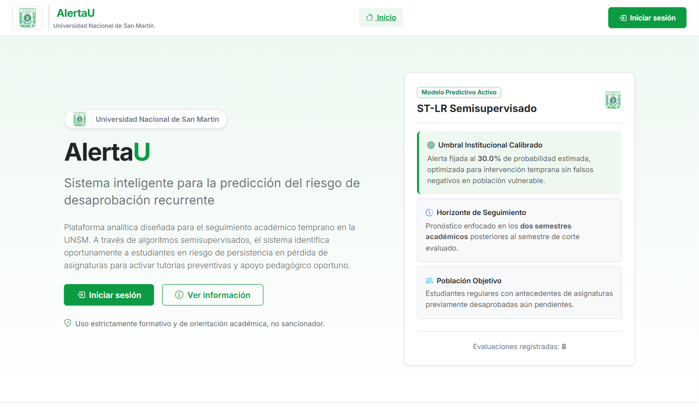
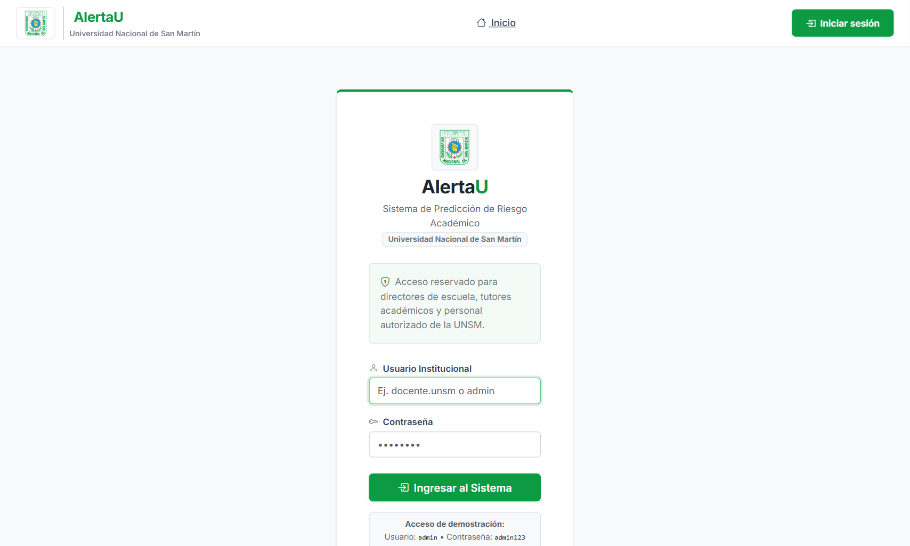
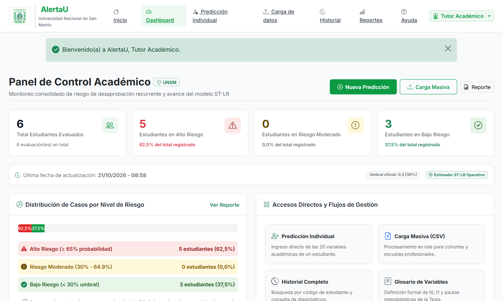
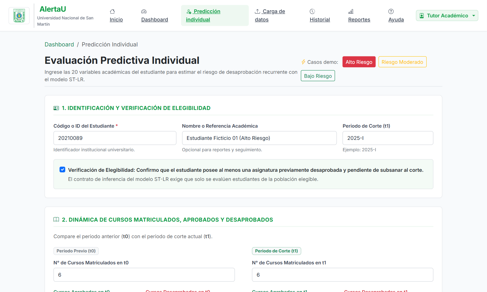
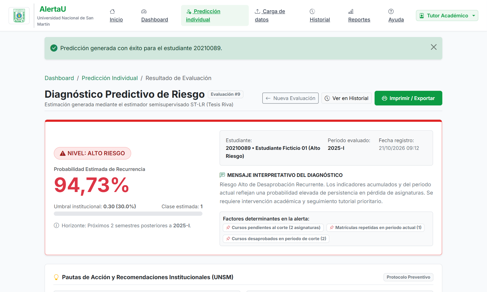
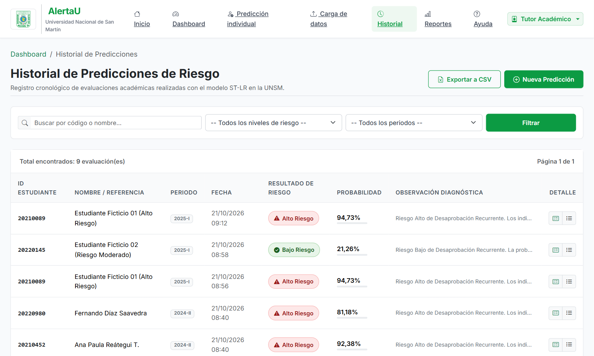
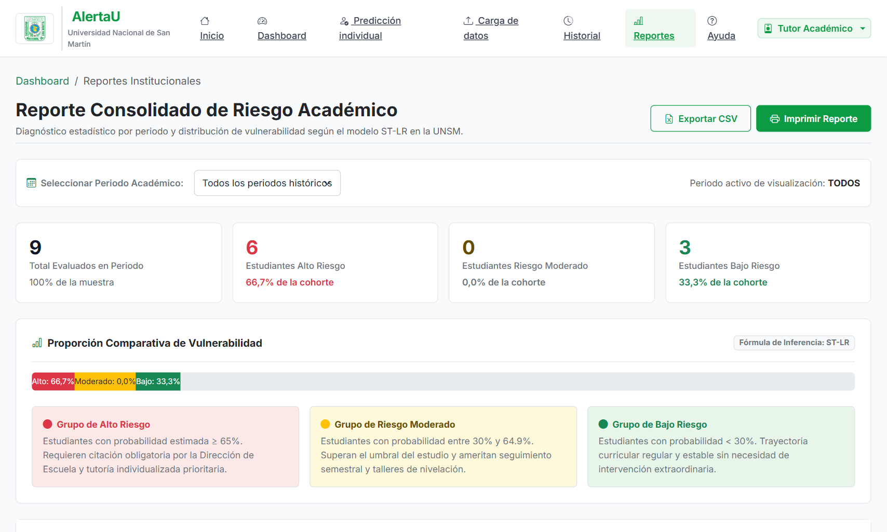

# AlertaU - Sistema de Predicción del Riesgo de Desaprobación Recurrente
### Universidad Nacional de San Martín (UNSM)

**AlertaU** es una aplicación web desarrollada en **Django** orientada al seguimiento académico temprano y a la predicción del riesgo de desaprobación recurrente en estudiantes universitarios de la **Universidad Nacional de San Martín (UNSM)**.

El sistema integra el modelo de Machine Learning semisupervisado **ST-LR (Self-Training Logistic Regression)** de la investigación de Tesis Riva, evaluando 20 variables académicas (periodos t0 y t1) bajo un umbral de decisión calibrado al **30.0%** y con fines formativos y preventivos no sancionadores.

---

## 📸 Capturas de Pantalla de la Plataforma

### 1. Portada Institucional / Inicio
Interfaz pública con identidad visual de la UNSM, pilares del sistema y accesos directos.


---

### 2. Inicio de Sesión Institucional
Acceso reservado para tutores y autoridades académicas.


---

### 3. Dashboard Principal y Monitoreo de Riesgo
Panel central con tarjetas métricas, distribución porcentual de vulnerabilidad y lista de evaluaciones recientes.


---

### 4. Evaluación Predictiva Individual (20 Variables Académicas)
Formulario organizado por bloques con validación de elegibilidad y botones de precarga de casos de prueba.


---

### 5. Diagnóstico Predictivo y Recomendaciones de Tutoría
Ficha de resultado con probabilidad calculada por el modelo ST-LR, nivel de riesgo visual y pautas de acción pedagógica de la UNSM.


---

### 6. Historial Cronológico de Predicciones
Tabla con filtros por código, nivel de riesgo y periodo académico, paginación y exportación a CSV.


---

### 7. Reportes Consolidados por Cohorte
Informes agregados por semestre lectivo con proporciones comparativas y opciones de impresión formal.


---

## 🎨 Identidad Visual y Paleta de Colores

Inspirada en los colores institucionales de la Universidad Nacional de San Martín:
- **Verde principal institucional:** `#0c9b43` (títulos destacados, botones principales, énfasis)
- **Verde suave:** `#66c28a` (detalles y bordes activos)
- **Verde muy claro / Fondo suave:** `#eef8f1` y `#f4fbf6`
- **Blanco:** `#ffffff` (color predominante de fondo y tarjetas limpias)
- **Gris suave:** `#e5e7eb` y `#f3f4f6` (bordes, fondos secundarios, tablas)
- **Texto principal:** `#1f2937`
- **Logo Institucional y Favicon:** Todas las vistas, la barra de navegación y el ícono de pestaña del navegador utilizan directamente el logo oficial de la UNSM ([`logo_unsm.png`](static/img/logo_unsm.png)).

---

## 🏗️ Estructura de Páginas del Sistema

1. **Página de Inicio / Portada (`/`):**
   - Nombre: **AlertaU**
   - Subtítulo: *Sistema inteligente para la predicción del riesgo de desaprobación recurrente*
   - Propósito institucional, pilares de detección temprana, logo oficial de la UNSM.
   - Botones de acceso: *Iniciar sesión*, *Ir al sistema*, *Ver información*.

2. **Página de Inicio de Sesión (`/login/`):**
   - Diseño limpio y sobrio en fondo blanco con acentos en verde institucional.
   - Campos de usuario y contraseña con autenticación Django.

3. **Dashboard Principal (`/dashboard/`):**
   - Resumen métrico:
     - Total de estudiantes evaluados.
     - Estudiantes en Alto Riesgo (rojo suave / `#fde8e8`).
     - Estudiantes en Riesgo Moderado (amarillo suave / `#fff9db`).
     - Estudiantes en Bajo Riesgo (verde suave / `#e8f5e9`).
     - Última fecha de actualización.
   - Barra comparativa y gráfica de distribución de riesgo.
   - Tabla de últimas evaluaciones registradas.

4. **Página de Predicción Individual (`/prediccion/individual/`):**
   - Formulario estructurado para las 20 variables académicas:
     - Confirmación de elegibilidad (antecedente de asignatura reprobada pendiente).
     - Cursos en t0 y t1, aprobados, desaprobados y retirados.
     - Calificaciones: Media simple, GPA semestral y GPA acumulado (escala vigesimal 0 a 20).
     - Créditos aprobados y totales en t0 y t1.
     - Factores críticos: matrículas repetidas en t1, desaprobaciones en historial y cursos pendientes al corte.
   - Botones interactivos para autocompletar casos demo en un clic (*Alto Riesgo*, *Riesgo Moderado*, *Bajo Riesgo*).
   - Botón: **Predecir Riesgo**.

5. **Página de Resultado de Predicción (`/prediccion/resultado/<id>/`):**
   - Identificación del estudiante y periodo evaluado.
   - Nivel de riesgo detectado con tarjetas limpias (Verde suave, Amarillo suave, Rojo suave).
   - Probabilidad estimada por el modelo ST-LR frente al umbral del 30.0%.
   - Mensaje interpretativo claro y factores determinantes destacados.
   - Pautas de acción y recomendaciones específicas de tutoría y nivelación para la UNSM.
   - Botón para imprimir / exportar reporte formal.

6. **Página de Historial de Predicciones (`/historial/`):**
   - Tabla ordenada: ID estudiante, fecha, resultado de riesgo, probabilidad, observación y opción de ver detalle.
   - Filtros de búsqueda por código/nombre, nivel de riesgo y periodo académico.
   - Paginación integrada y botón para **Exportar a CSV**.

7. **Página de Reportes (`/reportes/`):**
   - Filtro por periodo académico (ej. 2024-II, 2025-I, Todos).
   - Resumen estadístico y porcentual por categoría de vulnerabilidad.
   - Proporción comparativa con barra de progreso consolidada.
   - Opción para imprimir el informe o exportar los datos.

8. **Módulos Complementarios:**
   - **Carga Masiva (`/carga-masiva/`):** Procesamiento de archivos CSV por lotes con descarga de plantilla.
   - **Glosario y Ayuda (`/ayuda/`):** Definición operativa de periodos t0 y t1, glosario de las 20 variables y lineamientos éticos no sancionadores.

---

## 📁 Organización del Proyecto

```text
AlertaU/
├── alerta_u/                  # Configuración principal de Django
│   ├── settings.py            # Apps, localización (es-pe), estáticos, autenticación
│   ├── urls.py                # Rutas maestras y redirección de favicon.ico
│   └── wsgi.py
├── alertau_app/               # Aplicación AlertaU
│   ├── models.py              # Modelos Estudiante y PrediccionRiesgo
│   ├── views.py               # Vistas de todas las páginas del sistema
│   ├── forms.py               # Formulario de predicción individual
│   ├── urls.py                # Rutas internas
│   ├── ml_service.py          # Servicio de inferencia semisupervisada ST-LR
│   ├── tests.py               # Suite de pruebas automatizadas (100% aprobadas)
│   ├── admin.py               # Panel administrativo de Django
│   └── management/commands/
│       └── seed_data.py       # Comando para poblar usuario admin y casos demo
├── ST_LR/                     # Artefactos del modelo ML de Tesis Riva
│   ├── artefactos/            # modelo_final.joblib, preprocesador_V2.joblib, configs
│   └── inferencia_django.py   # Script de referencia de inferencia
├── docs/screenshots/          # Galería de capturas de pantalla de la plataforma
├── templates/alertau/         # Plantillas HTML con herencia base
│   ├── base.html              # Layout institucional con navbar y footer UNSM
│   ├── inicio.html            # Portada principal
│   ├── login.html             # Acceso institucional
│   ├── dashboard.html         # Panel de control y métricas
│   ├── prediccion_form.html   # Formulario de 20 variables
│   ├── prediccion_resultado.html # Diagnóstico y recomendaciones
│   ├── historial.html         # Registro histórico con filtros
│   ├── detalle.html           # Auditoría de factores evaluados
│   ├── reportes.html          # Reportes y filtros por periodo
│   ├── carga_masiva.html      # Subida por lote en CSV
│   └── ayuda.html             # Glosario t0/t1 y pautas metodológicas
├── static/
│   ├── css/custom.css         # Paleta institucional UNSM, tipografía y tarjetas
│   ├── js/main.js             # Interactividad y autocarga de casos demo
│   └── img/
│       ├── logo_unsm.png      # Logo oficial de la UNSM
│       ├── favicon.ico        # Favicon multi-resolución
│       └── favicon.png
├── requirements.txt           # Dependencias exactas de Python y scikit-learn 1.6.1
├── .gitignore                 # Exclusión de .venv, db.sqlite3, cache
└── manage.py
```

---

## 🚀 Ejecución y Acceso Local

1. **Activar el entorno virtual e instalar dependencias:**
   ```bash
   .venv\Scripts\activate
   pip install -r requirements.txt
   ```

2. **Aplicar migraciones y cargar datos iniciales de demostración:**
   ```bash
   python manage.py migrate
   python manage.py seed_data
   ```

3. **Iniciar el servidor:**
   ```bash
   python manage.py runserver
   ```
   Abra en su navegador: **http://127.0.0.1:8000/**

4. **Credenciales de Acceso Demo:**
   - **Usuario:** `admin`
   - **Contraseña:** `admin123`
